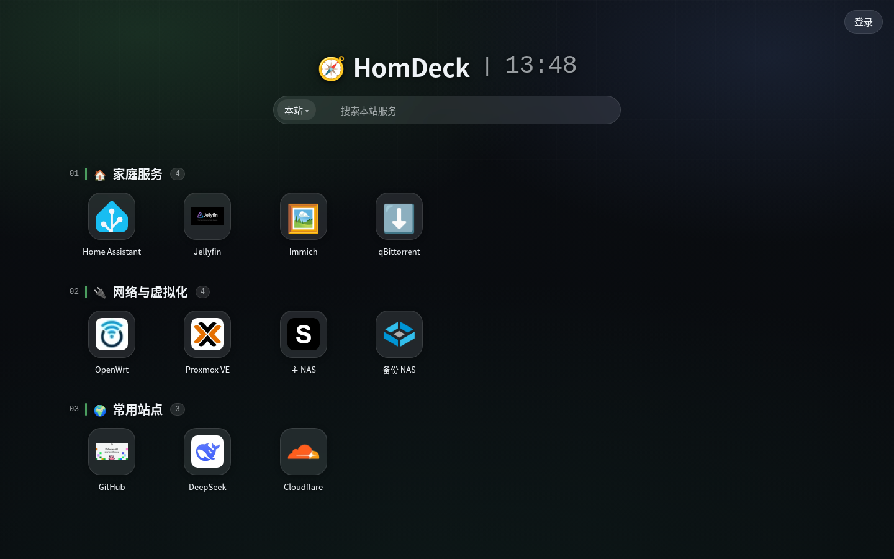
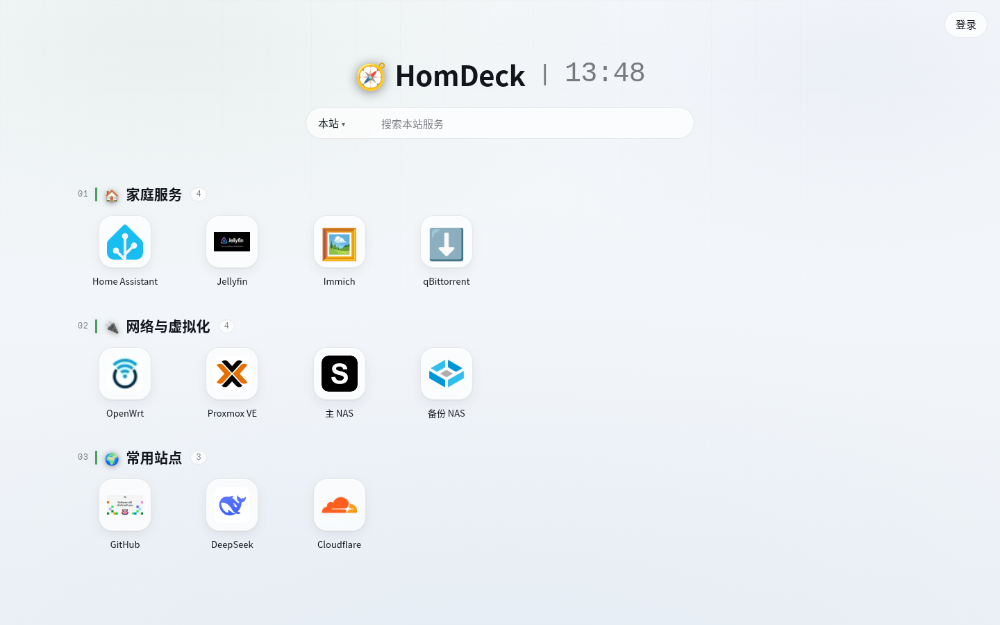
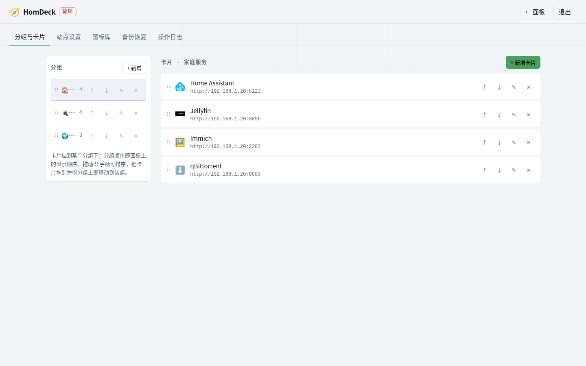
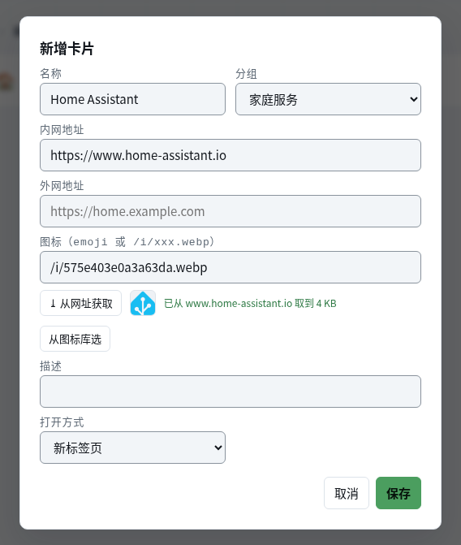

# HomDeck

**自托管的私有导航面板。** 一个容器、一个 SQLite 文件、7 个运行期依赖，零前端框架、零 CDN、零构建步骤。

内网访问自动免登录，外网访问自动用外网地址，卡片图标填个网址就能抓回来。



<p align="center"><sub>深色（上图）· 浅色（下图）· 同一份数据、同一套 DOM，只切 CSS 变量</sub></p>



---

## 目录

- [它解决什么问题](#它解决什么问题)
- [功能](#功能)
- [快速开始](#快速开始)
- [配置](#配置)
- [加卡片：图标从网址一键获取](#加卡片图标从网址一键获取)
- [接口](#接口)
- [安全基线](#安全基线)
- [备份与恢复](#备份与恢复)
- [目录结构](#目录结构)
- [怎么加自己的需求](#怎么加自己的需求)
- [FAQ](#faq)
- [和同类项目的取舍](#和同类项目的取舍)
- [路线图](#路线图)

---

## 它解决什么问题

家里 NAS、路由器、PVE、监控、各种自建服务的入口地址散落在书签栏和微信收藏里。你需要的不是又一个"漂亮的启动页"，而是：

1. **内网打开就免登录** —— 躺在沙发上点开就能用，不要每次输密码；
2. **在家和在外面用不同的地址** —— 同一个卡片，内网走 `192.168.x.x`，外网走域名；
3. **改成我想要的样子** —— 加个字段、改个布局、加个页面，不用学前端框架。

HomDeck 就这三件事，加上"代码要能自己看明白"。

它的起点是 Sun-Panel 的用户体验（壁纸舞台、居中时钟、玻璃卡片），但把实现换成了一套能长期自己维护的：**Python 标准库 SQLite 手写 SQL + Jinja2 + 原生 JS**，没有 ORM、没有打包器、没有 `node_modules`。

---

## 功能

### 面板（`/`）

| | |
|---|---|
| **内网免登录** | 按来源 IP 判定内网（CIDR 可配）。内网直接进，外网要求登录（可关） |
| **双地址自动切换** | 每张卡存内网/外网两个地址，按访问来源自动选；外网地址空则回退内网 |
| **搜索框三引擎** | `本站` / `百度` / `谷歌`，点左侧按钮切换，选择记在 localStorage。<br>本站模式即时过滤卡片；搜网页模式回车直接开新标签，`Ctrl/⌘+Enter` 不用切引擎也能搜 |
| **纯键盘操作** | 输入即筛选 → `↓` 进卡片 → 方向键按**网格几何**移动（不是简单上下一个）→ `Enter` 打开 → `Esc` 回搜索框 |
| **时钟与日期** | 大号时钟，鼠标悬停显示完整日期星期 |
| **主题** | `auto`（跟系统）/ `dark` / `light`，外加一个主色 accent，全部走 CSS 变量 |
| **零外链** | 字体用系统栈、图标本地存、无统计脚本、无字体 CDN、无 Google Fonts——断网也能完整显示 |

### 管理台（`/admin`）

- **分组 / 卡片**：增删改、隐藏分组、双地址、描述、打开方式（新标签/当前页）
- **排序**：可拖拽——拖 ⠿ 手柄换位置，把卡片拖到左侧分组即换组；也可用 ↑/↓ 按钮微调
- **图标库**：上传（Pillow 真实解码 → 统一转 webp）+ **从网址一键抓取** + 复用已有图标
  + **按内容去重**：同一张图不管从哪来、叫什么都只存一条，格子上标着「被 N 张卡片使用」
- **站点设置**：站点名、站点图标、主题、主色、内网 CIDR、页脚、是否强制登录
- **备份恢复**：下载 zip（库 + 图标），上传恢复（先自动把旧库备份成 `app.db.bak.<时间戳>`）
- **操作日志**：谁在什么时候改了什么，落 `audit` 表
- **改密码**：argon2id



---

## 快速开始

```bash
git clone https://github.com/st1341815/HomDeck.git
cd HomDeck

# 1. 数据目录必须提前建好并给对属主（容器内以 uid 10001 运行）
mkdir -p data && sudo chown -R 10001:10001 data

# 2. 配管理员密码
cp .env.example .env && vi .env     # 填 HOMEDECK_ADMIN_PASSWORD

# 3. 起
docker compose up -d --build

# 4. 验证
curl -s localhost:3302/health       # {"status":"ok","version":"0.7.0"}
```

打开 `http://<你的机器IP>:3302`。首次启动如果没给密码，程序会**随机生成一次**并打印到日志：

```bash
docker logs homedeck | grep 初始密码
```

> 不想用 Docker？`pip install -r requirements.txt && HOMEDECK_DATA=./data uvicorn app.main:app --port 8000`，一样跑。

---

## 配置

全部通过环境变量，没有隐藏配置文件。

| 变量 | 默认 | 说明 |
|---|---|---|
| `HOMEDECK_DATA` | `./data` | 数据目录（`app.db` / `icons/` / `secret.key`） |
| `HOMEDECK_ADMIN_USER` | `admin` | 首次启动创建的管理员账号 |
| `HOMEDECK_ADMIN_PASSWORD` | 空 | 留空则随机生成并打印到日志 |
| `HOMEDECK_SECRET` | 空 | 会话签名密钥。留空则生成一次存 `data/secret.key` |
| `HOMEDECK_TRUST_PROXY` | `0` | 放在反代后面时设 `1`，才会信 `X-Forwarded-For` |

其余可调项在 `app/config.py` 顶部集中定义：上传上限（512 KB）、图标最大边（512 px）、限流阈值（登录 5 次/分/IP、写操作 60 次/分/用户）、默认内网 CIDR。

**默认内网网段**：`127.0.0.1/32,192.168.0.0/16,10.0.0.0/8,172.16.0.0/12`。你的局域网不是 `192.168.0.0/16` 的话，在后台「站点设置 → 内网 CIDR」里改掉，否则外网会误判成内网（等于免登录）。

---

## 加卡片：图标从网址一键获取

这是 v0.7.0 加的能力，也是日常最省事的一步。



- 「内网地址」填完**停手 900ms，图标自己就来了**——不用点按钮，不用截图，不用找 favicon。
- 抓取顺序：`apple-touch-icon` → 尺寸最大的 `rel=icon` → `og:image` / `twitter:image` → `/favicon.ico`。
- 抓到后统一用 Pillow 转成 512 px 以内的 webp 存进图标库，卡片字段写 `/i/xxx.webp`。
- 手动改过图标输入框后就不再自动覆盖；编辑老卡片不会自动抓（不擅自换掉你选过的图标）。
- **内容去重**：抓回来的图按转码后的 sha256 比对，库里已有就直接复用那一条，
  不新建文件也不新建记录——同一个服务抓十次，图标库里始终只有一张。
- **允许内网地址**：`192.168.x.x` 正是主要目标，不做 SSRF 白名单。接口要管理员登录 + 20 次/分钟限流，能调它的人本来就有这个权限。

已知边界：只返回 SVG 图标的站点会被跳过（Pillow 解不了 SVG，也不引转码依赖），此时提示「找到候选但都取不到」，手动传一张即可。

---

## 接口

| 方法 | 路径 | 说明 |
|---|---|---|
| GET | `/` | 面板（内网免登录；`require_login=1` 时强制登录） |
| GET | `/api/panel` | 面板 JSON（按来源 IP 选内网/外网地址） |
| GET | `/health` | 健康检查（含版本号） |
| GET/POST | `/login` `/api/auth/login` | 登录（5 次/分钟/IP 限流） |
| POST | `/api/auth/logout` | 登出（需 CSRF） |
| GET | `/admin` | 管理台（需登录） |
| GET | `/api/admin/overview` | 分组 + 卡片 + 图标 + 设置 + 审计 |
| POST/PATCH/DELETE | `/api/admin/groups[/{id}]` | 分组 CRUD |
| POST/PATCH/DELETE | `/api/admin/items[/{id}]` | 卡片 CRUD |
| POST | `/api/admin/groups/reorder`<br>`/api/admin/items/reorder` | 排序 |
| POST/DELETE | `/api/admin/icons[/{id}]` | 图标上传 / 删除 |
| POST | `/api/admin/icon-from-url` | 从网址抓图标（20 次/分钟） |
| PUT | `/api/admin/settings` | 站点名、图标、主题、主色、`lan_cidrs`、页脚、`require_login` |
| POST | `/api/admin/password` | 改密码（≥8 位） |
| GET | `/api/admin/backup` | 下载 zip |
| POST | `/api/admin/restore` | 上传 zip 恢复（先自动备份旧库） |

写接口需要两个头：Cookie `hd_session` + `X-CSRF-Token`（值等于 Cookie `hd_csrf`）。

---

## 安全基线

| 项 | 做法 |
|---|---|
| 密码 | argon2id，不存明文、不存 MD5 |
| 会话 | itsdangerous 签名 Cookie，`HttpOnly` + `SameSite=Lax`，30 天 |
| CSRF | 双提交 Cookie + 请求头比对，所有写接口强制 |
| 限流 | 登录 5 次/分/IP；写操作 60 次/分/用户；抓图标 20 次/分 |
| 上传 | ≤512 KB、Pillow 真实解码、格式白名单、统一转 webp、随机文件名 |
| 出站网络 | **只有一处**：管理员点「从网址获取」时抓一次图标。其余全程零外链（无 CDN、无字体、无统计、无更新检查） |
| 响应头 | CSP（禁内联脚本）、`nosniff`、`X-Frame-Options`、`Referrer-Policy` |
| 容器 | 非 root（uid 10001）、`cap_drop: ALL`、`no-new-privileges` |
| SQL | 全手写 + 参数绑定，无 ORM、无字符串拼接 |

依赖清单（7 个，全 pin 版本）：
`fastapi uvicorn jinja2 python-multipart argon2-cffi itsdangerous pillow`

---

## 备份与恢复

- 后台「备份」→ 下载 `homedeck-YYYYMMDDhhmm.zip`（含 `app.db` + `icons/`）
- 恢复：上传同一个 zip，程序先把当前库复制成 `app.db.bak.<时间戳>` 再替换
- 手工兜底：停容器后 `cp -a data/ data.bak/` —— **整个 `data/` 目录就是全部状态**（含会话密钥）

---

## 目录结构

```
app/
  main.py           应用入口、中间件、全局异常
  config.py         全部环境变量与常量（VERSION 也在这）
  db.py             SQLite 连接、建表、设置、审计（无 ORM）
  security.py       argon2 密码、会话签名、CSRF、限流、内网判定
  rendering.py      Jinja2 渲染，统一注入站点信息/用户/CSRF
  routers/          health · auth · panel · admin · files
  services/         uploads（Pillow 校验转 webp）· favicon（抓图标）· backup（zip）
  templates/        base · panel · login · admin
  static/           css/app.css · js/{panel,login,admin}.js · favicon.svg
schema.sql          建表语句，唯一真相
scripts/            import_sunpanel.py（从 Sun-Panel 迁移）· fix_url_split.py
docs/               版本更新记录、截图
data/               运行时（app.db / icons / secret.key），备份 = 复制这个目录
```

代码量：Python 约 1200 行，CSS 约 1340 行，原生 JS 约 1000 行。

---

## 怎么加自己的需求

**① 加一个页面**

```python
# app/routers/mypage.py
from fastapi import APIRouter, Request
from ..rendering import render
router = APIRouter()

@router.get("/tools")
def tools(request: Request):
    return render("tools.html", request, {"rows": [1, 2, 3]})
```

`app/main.py` 的 include 列表加一行 → 新建 `app/templates/tools.html` → 重启容器。

**② 加一个接口**

同上，router 里加 `@router.get("/api/x")` 直接返回 dict/list。鉴权用 `security.require_admin(request)`，写操作用 `_guard()`（已含 CSRF + 限流 + 审计）。

**③ 改界面**

只动 `app/templates/*.html` 和 `app/static/css/app.css`，**没有构建步骤**，改完重启即生效。注意 CSP 禁内联脚本，事件绑定必须在 `static/js/*.js` 里 `addEventListener`。

---

## FAQ

**卡片点开用的是外网地址（或反之）？**
内网判定没匹配上。看后台「站点设置 → 内网 CIDR」，把 `192.168.0.0/16` 换成你的网段。也可以 `curl -s /api/panel | grep is_lan` 看当前判定结果。

**放在 Nginx / Lucky / Traefik 后面，所有人都被当成内网？**
反代过来源 IP 都是 `127.0.0.1`。设 `HOMEDECK_TRUST_PROXY=1`，并确保反代真的传了 `X-Forwarded-For`。

**忘记管理员密码？**
没有找回流程（本地应用，不需要邮箱验证那一套）。直接改库，一条命令：

```bash
docker exec -it homedeck python3 -c "
from app import db, security
db.run('UPDATE user SET password_hash=? WHERE username=?',
       (security.hash_password('你的新密码'), 'admin'))
print('done')
"
```

**从 Sun-Panel 搬家？**
`scripts/import_sunpanel.py` 能把分组、卡片、图标一起导过来（读 Sun-Panel 的 `database.db`）。
导完跑一次 `scripts/fix_url_split.py`，它按 URL 性质把公网域名从「内网地址」挪到「外网地址」——这是导入后最容易留下的坑。

**数据在哪？怎么整机迁移？**
停容器，`cp -a data/` 到新机器，起容器。`secret.key` 一起带走，否则所有人会话失效（但不影响数据）。

---

## 和同类项目的取舍

| | HomDeck | Sun-Panel | Homepage | Homer |
|---|---|---|---|---|
| 部署形态 | 单容器 + SQLite | 单容器 + SQLite | 容器 + YAML 配置 | 静态文件 |
| 加卡片方式 | 后台表单 | 后台表单 | 手写 YAML | 手写 YAML |
| 内网/外网双地址 | 内置，按来源自动选 | 无（一个 url） | 无 | 无 |
| 改 UI 要构建吗 | 不用，改完重启 | 需前端构建 | 改 YAML | 改 HTML |
| 出站请求 | 仅手动抓图标 | 有（图标代理/更新） | 有（widget 请求外部 API） | 无 |
| 适合谁 | 想自己改代码的人 | 想开箱即用的人 | 配置驱动、要 widget 的人 | 只要一个静态页的人 |

不是"更好"，是取舍不同：HomDeck 把"能自己改"放在第一位，代价是没有插件生态、没有 widget、没有多用户。

---

## 路线图

- [ ] 多账号 + 只读分享链接
- [ ] 卡片可达性探测（在线/离线小圆点，纯服务端定时探测）
- [ ] 打包成飞牛 fnOS `.fpk`
- [ ] 容器 `read_only: true` + tmpfs 加固

---

## 许可

MIT，见 [LICENSE](LICENSE)。拿去改，改成你自己的。
